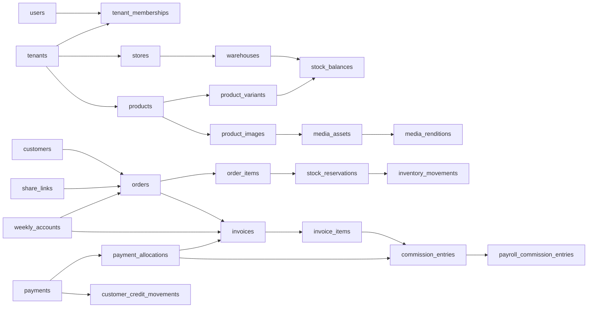

# Análisis inicial — BShop

**DOCUMENTO HISTÓRICO:** el enfoque multiempresa aquí descrito fue sustituido por
la decisión del propietario en `ARQUITECTURA_VIGENTE.md`. Usar README, API,
DESARROLLO y el tablero actuales para continuar el desarrollo.

Fecha: 2026-11-12. Alcance: documentos entregados, revisión estática del SQL y
herramientas locales. No constituye validación de DDL ni aceptación funcional.

**Nota de evolución:** este documento conserva el diagnóstico inicial. En la
iteración posterior se implementó la base F1/equipo y se validó el DDL de referencia
en MySQL 8.4.13 aislado. Estado y evidencia actuales: `PROGRESO.md`;
diagrama verificado: `ER_REFERENCIA.md`. Las brechas de dominio listadas siguen
pendientes de resolución durante F2 y módulos posteriores.

## 1. Fuentes y completitud

Se leyeron los cinco Markdown y el SQL completo de `E:\KEYLASHOP`:

| Fuente | Aporte |
|---|---|
| `01_PROMPT_MAESTRO_Codex.md` | Stack, invariantes, servicios y secuencia F0–F14 |
| `03_KEYLASHOP_MODELO_RELACIONAL_REFERENCIA_V3.sql` | 51 tablas y 100 declaraciones de FK |
| `03_KEYLASHOP_MODELO_RELACIONAL_REFERENCIA_V3 (1).sql` | Duplicado exacto del anterior |
| `06_IMAGENES_R2.md` | Pipeline de fotos, cuota, privacidad y recuperación de errores |
| `07_UX_UI_TABLET.md` | Navegación y flujo táctil de tres paneles |
| `10_ESTRATEGIA_DE_PRUEBAS.md` | QA-001 a QA-030 y evidencia requerida |
| `12_TODO_MAESTRO.md` | Hitos y criterios de aceptación por fase |

SHA-256 de ambos SQL:
`C60EA722763BB9B114E3F6B2B1B58E9DD6766461ACC93327829EA62D05A89FA5`.
No hay diferencias que fusionar; ambos originales se conservaron.

No se entregaron `00_LEER_PRIMERO.md`, `01_AUDITORIA_TECNICA_V2_1.md`, los
directorios `docs/`, `qa/`, `prompts/`, `sql/`,
`config/.env.example.keylashop` ni las imágenes
`assets/REFERENCIA_UI_DASHBOARD.png` y `assets/REFERENCIA_UI_APARTADOS.png`.
Por ello no se puede afirmar que esté disponible el paquete funcional completo.
Los textos imperativos del prompt recibido se analizaron como especificación;
no equivalen a autorización para ejecutar SQL o modificar infraestructura.

## 2. Qué se va a construir

SaaS web multiempresa, instalable como PWA y orientado primero a iPad/tablet.
Cada empresa tiene usuarios/roles, sucursales, almacenes, clientes, productos,
variantes y suscripción. Operación comercial: venta rápida, apartados, pedidos
por enlace de uso único, cuentas semanales, facturas PDF, abonos, crédito,
devoluciones y remuneración de vendedores.

Invariantes principales:

- Empresa y sucursal autorizadas en HTTP, servicios, trabajos y auditoría.
- Dinero `DECIMAL(19,4)` y aritmética decimal exacta; snapshots históricos.
- Disponible = físico menos reservado. Reservar no entrega; entregar reduce
  físico y reserva; cancelar libera únicamente la cantidad restante.
- Cambios de stock y movimientos inseparables en transacción con locks ordenados.
- Pago confirmado, aplicación a factura y crédito disponible son conceptos distintos.
- Cierre semanal, confirmación pública y operaciones financieras idempotentes.
- Comisión sobre cobros confirmados aplicados; reversión mediante nuevo asiento.
- Máximo cinco imágenes lógicas por producto y 2 GiB por empresa, incluyendo
  rendiciones y reservas pendientes; no 2 GiB por sucursal.
- GET del enlace nunca lo consume; POST lo consume en la misma transacción
  exitosa del pedido, visible al resto de conexiones después del commit.
- PWA sin mutaciones offline de inventario. Facturas comerciales PDF sin asumir
  emisión fiscal, pasarela, WhatsApp API ni nómina fiscal.

## 3. Entorno comprobado

`C:\xampp\php\www\BShop` estaba vacío al inicio. No había código ni repositorio
propio. No se encontraron instrucciones `AGENTS.md` en sus ancestros comprobados
ni `LOCAL_AI_WORKFLOW.md` en BShop o su directorio padre.

| Componente | Evidencia local | Evaluación |
|---|---|---|
| PHP CLI | 8.2.33, ZTS, `C:\xampp\php\php.exe` | Inferior al requisito de producto 8.3+ |
| Composer | 2.8.11; usa PHP 8.2.33 | Disponible |
| Node / npm | 24.4.0 / 11.4.2 | Disponibles; dependencias frontend aún sin resolver |
| Git | 2.55.0.windows.2 | Disponible; repositorio por definir |
| Motor instalado en XAMPP | 11.4.12-MariaDB, binario `mysqld.exe` | No es MySQL 8 |
| Apache, binario | 2.4.58 Win64 | Disponible; SAPI/vhost activo no verificados |
| Windows local | NT 10.0.26300.0 | No demuestra versión del VPS ni Windows Server |
| Laravel / Vue / Vite / Tailwind | Sin instalar en BShop | Ninguna versión resuelta |

PHP CLI tiene `bcmath`, `pdo_mysql`, `pdo_sqlite`, `fileinfo`, `gd`, `mbstring`,
`intl`, `openssl`, `curl`, `zip` y demás extensiones básicas de Laravel.
GD declara soporte WebP. CLI: memoria 512M, subida 10M y POST 60M;
`php.ini` cargado: `C:\xampp\php\php.ini`.
Esto no verifica los límites efectivos HTTP, Apache ni la resistencia a imágenes de 20 MP.

La documentación oficial de Laravel 12 permite PHP >=8.2. Por tanto, PHP 8.2
no es incompatible con el framework, pero sí incumple el mínimo 8.3+ del documento
de producto. Recomendación: runtime PHP 8.3+ dedicado al proyecto sin reemplazar
el PHP compartido de XAMPP; cualquier excepción debe quedar aprobada.

Referencia verificada mediante Context7:
https://github.com/laravel/docs/blob/12.x/deployment.md
https://github.com/laravel/docs/blob/12.x/installation.md

No se abrió conexión SQL: host efectivo, puerto, esquema, credenciales y versión
del servidor conectado siguen pendientes. No hubo consultas ni cambios de BD.

## 4. Auditoría estática del SQL

### Fortalezas

FK compuestas ampliamente utilizadas para tenant y, en operaciones relevantes,
cliente/sucursal/moneda; balances con `reserved <= on_hand`; reservas parciales;
ledger de crédito; snapshots de líneas; unicidad de enlace/pedido y de origen de
factura; consumo único de comisiones en nómina; outbox e idempotencia explícitos.

### Hallazgos que resolver antes de migraciones

Los siguientes son riesgos observables por lectura, no errores de ejecución demostrados.

| ID | Evidencia SQL | Consecuencia / tratamiento propuesto |
|---|---|---|
| SQL-01 | Cabecera v2.1 y comentarios 1191–1200 sobre local, frente a v3/R2 | Limpiar documentación de la copia de trabajo; R2 para catálogo según especificación recibida, local para staging/pruebas |
| SQL-02 | Líneas 9–11: `CREATE DATABASE keylashop`, `USE keylashop`, collation `utf8mb4_0900_ai_ci` | No ejecutar directamente: fijan destino y asumen dialecto. Migraciones con conexión explícita MySQL 8 de pruebas |
| SQL-03 | `employees.tenant_id` sin FK directa a tenants; membership/home_store permiten NULL | Si ambas son NULL, las FK compuestas no impiden tenant inexistente. Añadir FK directa |
| SQL-04 | `invoice_items` enlaza factura y order_item por separado | Permite línea de otro pedido/cliente/sucursal dentro del mismo tenant. Reforzar contexto y validar origen antes de insertar |
| SQL-05 | `commission_entries` enlaza item, allocation, refund y plan independientemente | No demuestra que allocation/refund correspondan a esa factura ni que vendedor/plan sean los del snapshot. Validar o reforzar claves contextuales |
| SQL-06 | `payroll_lines` referencia periodo sin moneda; `refunds` no lleva sucursal ni conecta devolución con moneda de factura | Falta garantía contextual completa; revisar FK/campos y validación transaccional de moneda/sucursal |
| SQL-07 | `media_upload_sessions` y `media_assets` no identifican producto destino ni bytes reservados por sesión | No hay vínculo directo para contar cargas pendientes de un producto o liberar exactamente cada reserva. Modelar destino/reserva y expiración |
| SQL-08 | `media_assets.status` no admite `failed`; documento R2 lo contempla | Unificar máquina de estados con transiciones/reintentos y `error_code` |
| SQL-09 | `uq_media_stage` usa `provider` en vez de `staging_provider` | La unicidad del objeto temporal queda asociada al proveedor final. Revisar índice con el namespace real del staging |
| SQL-10 | `chk_plan_mode` usa columnas anulables con `IN` | En SQL un CHECK puede aceptar UNKNOWN: comisión con base/trigger NULL o salario con periodo NULL requieren NOT NULL condicional explícito |
| SQL-11 | Secuencia por sucursal y número de factura único por tenant | Dos sucursales con mismo prefijo/número pueden colisionar. Definir numeración global o incorporar sucursal en número |
| SQL-12 | `product_images.is_primary`, `warehouses.is_default` sin unicidad condicional | Servicio/constraint debe impedir principales o almacenes predeterminados duplicados en su ámbito |
| SQL-13 | Quota `max_images_per_product BETWEEN 1 AND 20` | Más permisivo que el máximo comercial cinco. Definir si queda fijo en cinco o admite planes futuros aprobados |

Otras reglas no cubiertas sólo por el DDL: periodos semanales y contratos sin
solapamiento; suma de aplicaciones/reembolsos; devoluciones acumuladas; fórmulas
de totales; coherencia estados/cantidades; vendedor autorizado en sucursal;
relación del cliente del enlace con el cliente del pedido y de variantes con el
artículo devuelto. Deben tener validación de dominio y tests negativos concurrentes.

Faltan tablas de infraestructura propias del framework (sesiones, recuperación,
jobs/fallos según configuración), representación del administrador de plataforma
y persistencia explícita de documentos PDF históricos. Diseñarlas como parte de
F1/F2/F8 sin asumir que la referencia ya cubre toda la implementación.

## 5. Arquitectura de implementación propuesta

Monolito modular Laravel 12 + Vue 3/TypeScript, Vite y Tailwind; SPA same-origin
con Sanctum/sesión/CSRF y API JSON `/api/v1`. Propuesta de organización:

```text
app/Domain/{Tenancy,Catalog,Media,Inventory,Sales,Billing,Payments,Payroll,Saas}
app/Http/{Controllers/Api/V1,Requests,Middleware,Resources}
app/Policies
app/Jobs
database/{migrations,factories,seeders}
resources/js/{components,layouts,pages,composables,types}
tests/{Unit,Feature,Integration}
docs/
qa/
```

TenantContext debe fallar cerrado si falta contexto; el slug es localizador,
no autorización. Policies por acción y acceso positivo de sucursal. DTOs/servicios
reciben contexto validado; nunca aceptar tenant_id del cliente como autoridad.
Serializar dinero como cadenas y no confiar en totales calculados por navegador.

Media: staging privado → validar bytes/MIME/píxeles → WebP 320/640/1600 sin
ampliar → publicar tres derivados → ready. Locks SQL cortos, sin comprimir/subir
durante una transacción abierta. Saga compensatoria, outbox y reconciliación.
El bucket público sólo contendrá derivados aprobados; cuota por objetos físicos.

Jobs/scheduler/worker deberán operar como procesos persistentes en Windows;
no se presupone Docker, Linux ni Supervisor. DocumentRoot del futuro sitio:
`C:\xampp\php\www\BShop\public`. Verificar antes de exponerlo por Apache.

### Mapa conceptual de relaciones (no sustituye el ER completo)



## 6. Decisiones confirmadas y pendientes

Confirmación del propietario: **BShop** es el nombre del sistema y **KeylaShop**
es la primera empresa usuaria (tenant). Los documentos de origen conservan su
nombre histórico. La marca de la plataforma debe ser BShop y el nombre de la
empresa debe provenir del tenant activo, sin quedar fijo en pantallas o lógica.
La cuenta personal del propietario de KeylaShop aún está por definir.

| Prioridad | Decisión | Bloque afectado |
|---|---|---|
| Media | Identidad visual de BShop y personalización de marca de cada empresa | Branding, correos, manifiesto PWA |
| Alta | PHP 8.3+ dedicado y MySQL 8 local separado: ubicación y conexión de pruebas | F0/F1/F2 |
| Alta | Entregar documentos funcionales faltantes o confirmar que estos son la base vigente | Reglas del dominio |
| Alta | Moneda real (SQL propone USD), decimales, redondeo, impuestos incluidos/excluidos | Importes/facturas |
| Alta | Día/hora y zona de cierre, entregas parciales y criterio de inclusión en factura semanal | F6/F8 |
| Alta | Vencimiento/cancelación de apartados con abonos y tratamiento del crédito | F5/F9 |
| Alta | Base elegible de comisión, distribución de abonos entre líneas/descuentos/impuestos/envío, fecha del contrato aplicable | F9/F10 |
| Media | Enlace ligado a cliente existente o identificación/alta pública; caducidad | F7 |
| Media | Facturar antes de entregar, alcance de devoluciones/anulaciones y numeración por sucursal | F8/F9 |
| Media | Cálculo de sueldo por periodos parciales y nómina neta negativa tras reversión | F10 |
| Media | Planes/límites, suspensión, exportación y quién crea empresas | F1/F12 |
| Media | Dominio/buckets/cuenta R2, retención documental y respaldo de objetos | F4/F14 |

Valores DEFAULT del SQL y sugerencias visuales no se consideran decisiones del
propietario. Las reglas fiscales o de cálculo pendientes no deben inventarse.

## 7. Plan de arranque y criterios verificables

1. **Cerrar F0 técnico:** completar fuentes o registrar su ausencia, decidir
   runtime, provisionar conexión de pruebas MySQL 8 y crear repositorio/CI cuando
   se defina destino. Antes de cada comando SQL mostrar conexión, host, base y
   entorno efectivos. No usar `keylashop` implícito del SQL.
2. **Validar modelo:** preparar DDL/migraciones sin CREATE DATABASE/USE embebidos,
   resolver SQL-01…13; en esquema de pruebas separado verificar FK/CHECK/índices
   por INFORMATION_SCHEMA y tests negativos. Elaborar ER completo. SQLite sólo
   sirve a pruebas que no dependan de semántica InnoDB.
3. **F1 base:** Laravel/Vue, entorno de ejemplo sin secretos, sesión/CSRF,
   recuperación de acceso, tenants, memberships, roles, sucursales y auditoría.
   Entregable: QA-001/002 con dos empresas y accesos cruzados denegados.
4. **F2:** migraciones/factories y validación real de constraints. Dependencia
   práctica: F1 ya requiere migraciones mínimas de identidad/tenant; F2 completa
   el modelo, no se difiere toda persistencia hasta después de F1.
5. **F3→F5:** catálogo/variantes → imágenes/cuotas → inventario/reservas/kardex.
   UI incremental desde estos módulos; QA de stock concurrente antes de pedidos.
6. **F6→F10:** clientes/apartados → enlace → cierres/PDF → pagos/crédito/returns
   → comisiones/nómina. QA-006…017 y pruebas reales con dos conexiones.
7. **F11→F14:** consolidar tablet/PWA, SaaS/reportes, QA integral y restauración;
   staging y despliegue con autorización específica de producción.

Primera demo útil: dos empresas aisladas, inicio de sesión, selección de sucursal
y CRUD básico autorizado. Primera demo de negocio: cliente → variante → apartado
→ entrega/cancelación con stock conciliado. No presentar un dashboard estático
como implementación de inventario o finanzas.

## 8. Estado de validación

Confirmados: lectura, duplicidad SQL, carpeta vacía y versiones/capacidades CLI.
Pendientes: DDL MySQL, FK reales, seguridad HTTP, build frontend, R2, concurrencia,
Safari/iPad, backup/restore y entorno VPS. F0 completo todavía no está acreditado.
